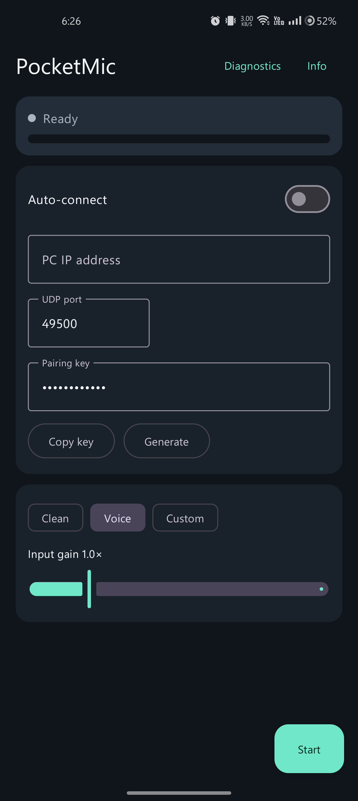
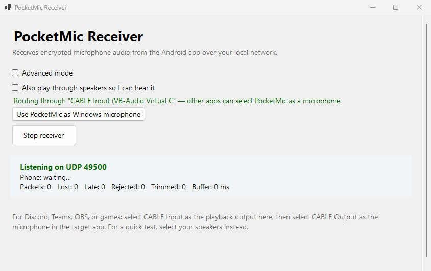

# PocketMic LAN

[](https://github.com/ryanspice/pocketmic-lan/releases)
[](https://github.com/ryanspice/pocketmic-lan/actions/workflows/ci.yml)
[](https://github.com/ryanspice/pocketmic-lan/actions/workflows/ios.yml)
[](https://github.com/ryanspice/pocketmic-lan/actions/workflows/macos.yml)
[](https://github.com/ryanspice/pocketmic-lan/actions/workflows/lighthouse.yml)
[](LICENSE)
[]()

**v1.7.0** · Encrypted wireless microphone for your PC

PocketMic turns an Android phone into an encrypted wireless microphone for a Windows PC on the same private LAN. It sends 48 kHz mono audio over UDP, with AES-256-GCM on every audio packet. No account or cloud relay is required. PCM16 is the default working path; The Windows package includes the native Opus decoder; physical end-to-end Opus and prolonged-session acceptance remain separate from automated tests.

**Live site:** [canopydigital.ca/sites/pocketmic-lan/](https://canopydigital.ca/sites/pocketmic-lan/)

### Release and source status

The consolidated `main` source is **1.7.0**, covering Windows and Android fixes, native Opus packaging, a per-user Windows installer, and a Windows 11 Mica frame. The previous development candidate is archived as `v0.1.6`. A release tag is created only after the candidate workflows pass; consult GitHub Releases for published download availability. See [the 1.7 release plan and verification record](RELEASE-1.7.0.md).

The Android application ID is now `com.canopydigital.pocketmic`: it installs separately from v0.1.5 (`com.ryanspice.pocketmic`) and does not migrate its pairing settings. Android builds are debug-signed; Windows packages are unsigned. Apple source is retained and checked in CI, with macOS/iOS development acceptance targeted for **1.7.1**. These are not App Store, TestFlight, or notarized installers.

## Project links

- Source: <https://github.com/ryanspice/pocketmic-lan>
- Releases: <https://github.com/ryanspice/pocketmic-lan/releases>
- Android APK (debug signed): <https://github.com/ryanspice/pocketmic-lan/releases/download/v1.7.0/app-debug.apk>
- Windows receiver: <https://github.com/ryanspice/pocketmic-lan/releases/download/v1.7.0/PocketMicReceiver-win-x64.zip>
- Release checksums: <https://github.com/ryanspice/pocketmic-lan/releases/download/v1.7.0/SHA256SUMS.txt>
- Marketing site: <https://canopydigital.ca/sites/pocketmic-lan/>

## What is included

| Component | Stack | Description |
|-----------|-------|-------------|
| Android transmitter | Kotlin, Jetpack Compose | Foreground microphone service with QR pairing |
| Windows receiver | C#/.NET 8, WinForms, NAudio 2.3 | Audio playback with voice processing |
| macOS receiver preview | SwiftUI, CoreAudio Audio Server Plug-in | Unsigned PCM v1 receiver and virtual microphone under physical-Mac testing; see [macOS preview setup](macos/README.md) |
| Wire protocol | UDP, AES-256-GCM | v1: PCM16 (768 kbit/s), v2: Opus (~106 kbit/s), 10 ms packets |
| Control channel | HMAC-SHA256 | Discovery, statistics, DSP config on `audioPort + 1` |

Additional capabilities:
- QR code pairing — scan from phone, zero manual IP entry
- LAN receiver discovery with an Available PCs list, refresh, and manual IPv4 fallback
- VB-CABLE routing for Windows app audio; an installable PocketMic virtual device remains planned
- Adaptive receiver buffering and Android Wi-Fi lock policies
- Opus encoding/decoding with bundled Windows `opus.dll` and its licence
- Clean, voice-processed, and custom Android capture modes; Windows voice processing is controlled separately
- Adjustable input gain and live input level meter
- Selectable Windows playback device (speakers, VB-CABLE, VoiceMeeter)
- Prebuffering, bounded loss concealment, rollover-safe sequencing
- Auto-reconnect with discovery resume on link loss
- Wi-Fi lock policy (LOW_LATENCY / HIGH_PERF) fed by live network state
- Pairing key encrypted at rest on Android (EncryptedSharedPreferences)
- Session diagnostics with exportable Markdown reports
- Build, firewall, protocol, and source verification tools

## Screenshots

| Android transmitter | Windows receiver |
|:---:|:---:|
|  |  |
| Connection, QR pairing, capture modes | Device selection, voice processing, diagnostics |

Captured from earlier v0.1.5 artifacts on a OnePlus 9 Pro and Windows 11 PC. These screenshots do not show the newer Available PCs list or QR address selector.

## Build on Windows 11

Requirements:

- Android Studio with Android SDK Platform 36
- Android NDK `27.2.12479018` and CMake `3.22.1`, installed through SDK Manager
- Android Studio's bundled JBR or another JDK 17+
- .NET 8 SDK
- Python 3 (optional — verification scripts)

From the repo root:

```powershell
Set-ExecutionPolicy -Scope Process Bypass

.\scripts\setup-libopus.ps1
.\scripts\build-android.ps1
.\scripts\publish-windows.ps1
```

Run `setup-libopus.ps1` once to download and verify the pinned libopus source used by the Android native build. The Android build script uses the committed Gradle wrapper and runs JVM unit tests, Android lint, and the requested APK build by default. The Windows publish script creates a self-contained x64 package; it does not run tests or supply the native Opus DLL.

Expected outputs:

The Android helper derives the APK filename from Gradle's `versionName`; on 1.7.0 it is:

```text
release\PocketMic-v1.7.0-debug.apk
release\PocketMicReceiver-win-x64.zip
```

Install or update the Android app:

Version 1.7.0 uses the new application ID `com.canopydigital.pocketmic`. It installs separately from v0.1.5 (`com.ryanspice.pocketmic`); Android does not automatically move the old app's settings or pairing key. Stop any stream in the old app, open the new app, and pair it again. The old app can remain installed until the new one is working. `adb install -r` updates only an app with the same application ID and signing certificate. Use the release APK consistently: a locally built or CI debug APK can have a different certificate and may not update an existing installation.

```powershell
adb install -r .\release\PocketMic-v1.7.0-debug.apk
```

### Faster rebuilds

```powershell
.\scripts\build-android.ps1 -SkipClean                    # keep build cache
.\scripts\build-android.ps1 -SkipClean -SkipChecks        # skip tests/lint
.\scripts\build-android.ps1 -Configuration Release        # unsigned release APK
```

## How it works

1. **Open the receiver.** Extract the Windows ZIP and run `PocketMicReceiver.exe`. Current source generates and saves a pairing key on first run, then starts listening automatically. The automatic-listening preference can be changed in Advanced settings. Existing settings are preserved, including an earlier choice to disable auto-listen.
2. **Pair the phone.** Open PocketMic on Android and tap "Scan QR". Allow camera access, then scan the PC's "Show QR for phone" code. IP, port, and key fill in automatically. If the PC has several network addresses, choose the one on the phone's LAN in the QR dialog. "Available PCs" lists receivers that answer discovery; select a PC to fill its address, then scan its QR or enter its pairing key if needed. "Refresh PCs" retries discovery, and manual fields remain available when automatic connection fails. A `pmic://` link opened on Android can also fill the connection details while idle.
3. **Select the destination.** Choose speakers for a test, or `CABLE Input` for routing into Discord/Teams/OBS.
4. **Tap Start.** The phone captures at 48 kHz, encrypts every 10 ms frame with AES-256-GCM, and streams over UDP.

### Route into Discord, Teams, OBS, or a game

1. Install [VB-Audio VB-CABLE](https://vb-audio.com/Cable/). An installable PocketMic virtual audio device is on the roadmap.
2. Select `CABLE Input` in PocketMic Receiver.
3. Select `CABLE Output` as the microphone in the target application.

The receiver has a "Use PocketMic as Windows microphone" button that selects the available cable recording endpoint as the system default. A virtual cable must already be installed; PocketMic does not install its own microphone driver.

### If discovery or QR pairing fails

- Keep both devices on the same LAN. Guest Wi-Fi, client isolation, and firewall rules can prevent PCs from appearing in the list.
- Confirm the receiver is listening. For an existing installation with auto-listen disabled, start it manually or enable the preference.
- Use "Refresh PCs", select the intended PC, and confirm its pairing key. Discovery can display a receiver whose key differs from the phone's key; audio still requires the correct key.
- If the list stays empty, enter the PC's LAN IPv4 address, audio port, and pairing key manually. For QR pairing, select the corresponding LAN address in the desktop dialog and allow camera permission on the phone.
- Current source binds phone sockets to a local Wi-Fi or Ethernet network when available, including when a VPN is the default route. Changing networks during a stream still needs device testing.

## Windows Firewall

Allow the selected audio UDP port, its control port (`audioPort + 1`), and standard discovery port `49501` on **Private networks** only. Default audio port: `49500`. A receiver using a custom audio port also answers probes on `49501`, so a fresh phone can find it. Older receivers require their custom port to be entered or scanned.

```powershell
.\scripts\allow-firewall.ps1
.\scripts\allow-firewall.ps1 -Port 49520
```

## Verification

The Android build runs Kotlin/JVM tests and lint by default. The Windows receiver suite includes native Opus smoke coverage, and hosted CI runs the Windows build and full test suite. Standalone protocol checks:

```powershell
python .\tools\verify_protocol.py
python .\tools\verify_receiver_logic.py
python .\scripts\verify_release_versions.py
python .\tools\verify_web.py
```

`verify_release_versions.py` checks current platform versions and build numbers. The legacy `tools/verify_source.py` and `SOURCE_SHA256SUMS.txt` describe an older baseline and are not current release checks. See [PERFORMANCE_AUDIT.md](PERFORMANCE_AUDIT.md) and [STABILIZATION-PLAN.md](STABILIZATION-PLAN.md) for historical evidence and pending acceptance work.

## Performance profile

These are source configuration values and PCM payload calculations, not new end-to-end latency measurements:

| Metric | Value | Notes |
|--------|-------|-------|
| Prebuffer | 100 ms | Adjustable 40–300 ms on receiver |
| High-water mark | 220 ms | Buffered latency trimmed above this |
| Concealment | 200 ms | Max 20 packets of decayed-repeat fill |
| Raw bandwidth | 768 kbit/s | 48 kHz mono PCM16 |
| Packet rate | 100/s | 10 ms per packet |

Additional performance characteristics:
- Android encryption/header/packet buffers reused in the hot path
- Capture and send decoupled: bounded 8-packet drop-oldest queue
- Input meter at 10 Hz, not per packet
- Wi-Fi lock policy re-evaluated every 10 s against live network

Adaptive policies can alter effective buffering. See [PERFORMANCE_AUDIT.md](PERFORMANCE_AUDIT.md) for the historical device audit and open jitter, loss, latency, and Wi-Fi lock acceptance checks.

## Security and network boundary

| Property | Value |
|----------|-------|
| Key | `SHA-256(UTF-8(pairing key))` |
| Cipher | AES-256-GCM |
| Nonce | Random 64-bit session ID + unsigned 32-bit sequence |
| AAD | Complete header: 24 bytes for v1, 28 bytes for v2 |
| Android key at rest | EncryptedSharedPreferences backed by Android Keystore |
| Windows key at rest | Plaintext user settings in `%APPDATA%\PocketMic\receiver.json` |
| Control channel | HMAC-SHA256, domain-separated key |
| Scope | Trusted private LAN only |

Do not port-forward the receiver. Encryption protects packet contents and integrity; it does not make this a hardened internet voice service.

## Current limits

- iOS has an initial PCM streaming client in `ios/`. It uses SwiftUI and XcodeGen, so Windows contributors can edit it and rely on the macOS GitHub Actions runner to generate the Xcode project and build it. Pull requests and `codex/**` pushes build an unsigned simulator app; version tags and published GitHub releases produce an unsigned `.xcarchive`.
- Windows receiver plus an unsigned macOS receiver and CoreAudio virtual-microphone preview; see [macOS tester setup](macos/README.md). No Linux receiver is included yet; Linux is planned after v0.1.6.
- Android provides LAN discovery, QR pairing, and manual IPv4 fallback for Windows. The current iOS and macOS previews use manual pairing; iOS QR pairing and Mac receiver discovery are not implemented.
- Windows supports PCM v1 and Opus v2 when `opus.dll` is present. The Mac receiver and initial iOS client use PCM v1; Opus is optional on Android. Physical codec/interoperability checks remain open.
- Android is a debug-signed development build; Windows, iOS, and macOS packages are unsigned. Windows includes a per-user installer in its ZIP; there is no automatic updater.
- No internet relay — both devices must be on the same LAN
- Designed for voice, not real-time music monitoring

### iOS signing and TestFlight

The iOS workflow does not sign or upload builds. To prepare a future signed TestFlight/App Store workflow, add these as encrypted GitHub Actions repository secrets under **Settings → Secrets and variables → Actions**:

- `IOS_CERTIFICATE_P12_BASE64` — base64-encoded Apple Distribution `.p12` certificate.
- `IOS_CERTIFICATE_PASSWORD` — password used to export that certificate.
- `IOS_PROVISIONING_PROFILE_BASE64` — base64-encoded App Store provisioning profile for the app's bundle identifier.
- `APP_STORE_CONNECT_API_KEY_ID` — App Store Connect API key ID.
- `APP_STORE_CONNECT_ISSUER_ID` — App Store Connect issuer ID.
- `APP_STORE_CONNECT_API_PRIVATE_KEY` — contents of the API key `.p8` file.

An active Apple Developer Program membership and an App Store Connect app record are also required for TestFlight/App Store distribution. These secrets are not needed for the current unsigned CI builds. Do not commit certificates, profiles, or API keys to the repository.

## Project layout

```text
android/                 Kotlin Android transmitter
windows-receiver/        C# WinForms receiver UI
windows-receiver-core/   C# shared engine, audio pipeline, protocol
windows-receiver-tests/  C# xUnit and native codec tests
scripts/                 PowerShell build, publish, and firewall helpers
tools/                   Python protocol, logic, source, and web verification
web/                     Static marketing site (HTML/CSS/JS, zero deps)
CHANGELOG.md             Version history
PROTOCOL.md              Wire format and encryption spec
PERFORMANCE_AUDIT.md     Audit findings, fixes, and measured data
STABILIZATION-PLAN.md    Release validation and acceptance gates
ROADMAP.md               Product direction (historical; reconcile with current source)
```

## License

MIT

## Support

If PocketMic is useful to you, consider buying me a coffee:

[](https://www.buymeacoffee.com/ryanspice)
